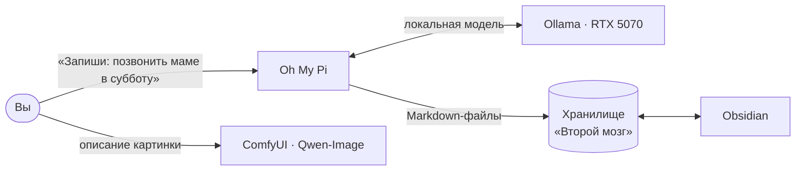

<div align="center">

# 🧠 Второй мозг

**Личный ИИ-помощник для заметок и генерации картинок — полностью на вашем компьютере.**

Установка в один двойной клик для Windows 11 и видеокарты NVIDIA RTX.
Без подписок, без облака, без отправки ваших данных куда-либо.


</div>

---

## Что это

Скрипт ставит и связывает между собой четыре программы, чтобы человек без опыта в ИИ получил готовый инструмент:

| | Компонент | Зачем |
|---|---|---|
| 💬 | **[Oh My Pi](https://github.com/can1357/oh-my-pi)** | ИИ-агент: вы пишете обычным языком — он записывает, ищет и раскладывает заметки по папкам |
| 🦙 | **[Ollama](https://ollama.com)** | Запускает языковые модели прямо на видеокарте |
| 📓 | **[Obsidian](https://obsidian.md)** | Удобно читать и править заметки, которые ведёт помощник |
| 🎨 | **[ComfyUI](https://github.com/Comfy-Org/ComfyUI)** + Qwen-Image 2.1 | Генерация картинок по текстовому описанию |



## Быстрый старт

1. Нажмите **Code → Download ZIP** и **распакуйте** архив (запуск прямо из ZIP не сработает).
2. Дважды щёлкните **`УСТАНОВИТЬ.cmd`**.
   Если Windows покажет «Система Windows защитила ваш компьютер» — **Подробнее → Выполнить в любом случае**.
3. Дождитесь надписи **«ГОТОВО!»** (40–120 минут, в основном скачивание моделей).
4. На рабочем столе появятся ярлыки:

   | Ярлык | Что открывает |
   |---|---|
   | **Второй мозг (ИИ)** | Помощник на быстрой модели — для повседневных записей |
   | **Второй мозг — умный режим (ИИ)** | Помощник на большой модели — для сложных вопросов |
   | **Заметки (Obsidian)** | Ваши заметки |
   | **Картинки (ComfyUI)** | Генерация изображений в браузере |

Подробная инструкция простым языком — в **[ИНСТРУКЦИЯ.txt](ИНСТРУКЦИЯ.txt)**.

## Что нужно

- Windows 11 (winget уже встроен)
- Видеокарта NVIDIA с 12 ГБ памяти (рассчитано на **RTX 5070**), драйвер **570+**
- 60 ГБ свободного места на диске C:, около 40 ГБ трафика
- Оперативная память: 16 ГБ минимум, **32 ГБ** желательно для картинок

WSL не нужен — всё работает напрямую в Windows.

## Модели

| Роль | Модель | Размер | Почему |
|---|---|---:|---|
| Основная | [`qwen3.5:9b`](https://ollama.com/library/qwen3.5) | 7,6 ГБ | Умеет вызывать инструменты, целиком помещается в 12 ГБ |
| Быстрая | [`qwen3.5:4b`](https://ollama.com/library/qwen3.5) | 4,0 ГБ | Простые служебные задачи агента |
| Умный режим | [`bonsai-2:27b`](https://ollama.com/library/bonsai-2) | 8,3 ГБ | 27B в тернарном формате (1,58 бит) — умнее, но медленнее |
| Картинки | [Qwen-Image 2.1 Uncensored](https://huggingface.co/abenzerps/Qwen-Image-2.1-Uncensored-Quantized) | 16 ГБ | int8-версия для ComfyUI; энкодер выгружается в ОЗУ |

Ollama настраивается под 12 ГБ: контекст 32k токенов, flash attention, KV-кэш `q8_0`.

## Что делает установщик

1. Проверяет драйвер NVIDIA, место на диске и память.
2. Через `winget` ставит Git, Ollama, Obsidian, 7-Zip и Visual C++ Runtime.
3. Настраивает Ollama и скачивает модели.
4. Ставит Oh My Pi официальным установщиком (с проверкой SHA-256) и подключает его к локальным моделям.
5. Создаёт хранилище заметок с папками по методу PARA и инструкцией для ИИ (`.omp/AGENTS.md`): отвечать просто, ничего не удалять без согласия, работать только внутри папки заметок.
6. Ставит ComfyUI portable и модель картинок. Версии и контрольные суммы зафиксированы, оборванные загрузки докачиваются.
7. Кладёт ярлыки на рабочий стол и проверяет, что модели работают на видеокарте.

Скрипт можно запускать повторно: уже установленное пропускается. Журнал установки — `%TEMP%\second-brain-setup.log`.

### Параметры

```powershell
.\setup.ps1 -VaultPath "D:\Заметки"    # своё место для заметок
.\setup.ps1 -MainModel gemma4:12b      # другая основная модель
.\setup.ps1 -SmartModel ""             # без умного режима
.\setup.ps1 -SkipImages                # без генерации картинок (−20 ГБ)
.\setup.ps1 -ImagesPath "D:\AI"        # ComfyUI на другой диск
.\setup.ps1 -SkipModels                # не скачивать модели Ollama
```

## Файлы

```
├── УСТАНОВИТЬ.cmd                   ← запускать это
├── setup.ps1                        установщик
├── qwen-image-2.1-uncensored.json   готовый сценарий ComfyUI
├── ИНСТРУКЦИЯ.txt                   инструкция для пользователя
└── README.md
```

## Важно

- **Генерация картинок без фильтров.** Модель создаёт любой контент, включая взрослый. Ответственность за созданное лежит на пользователе. Изображения реальных людей без их согласия и любые материалы с несовершеннолетними запрещены законом.
- **Лицензии.** Qwen-Image 2.1 распространяется по лицензии Qwen Research (некоммерческое использование). У каждой программы и модели своя лицензия — смотрите ссылки выше.
- **Локальные модели ошибаются чаще облачных.** Важные заметки стоит перепроверять. Подключить облачную модель можно командой `/login` в окне помощника.
- Скрипт проверен на синтаксис и по частям, но **полный прогон на чистой машине с Windows ещё не проводился**. Если что-то не сработает — откройте issue и приложите журнал установки.
